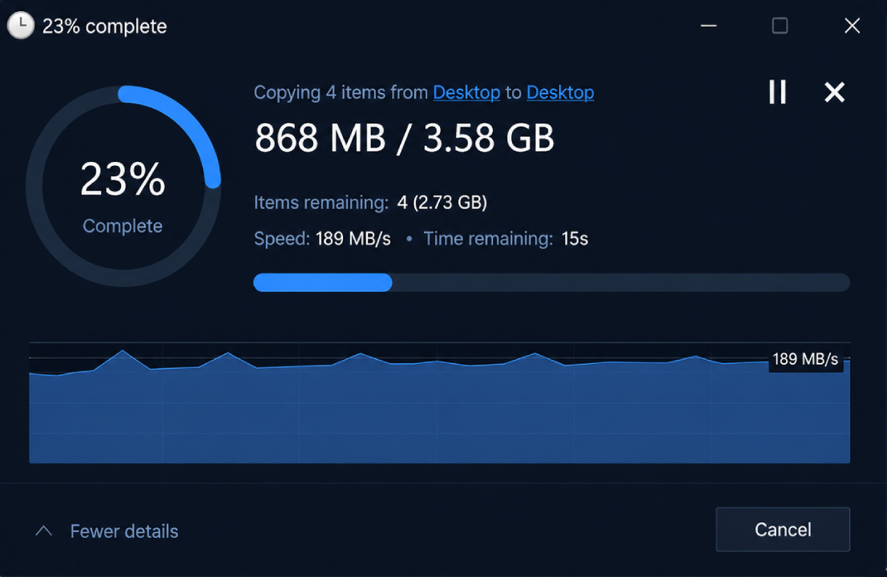
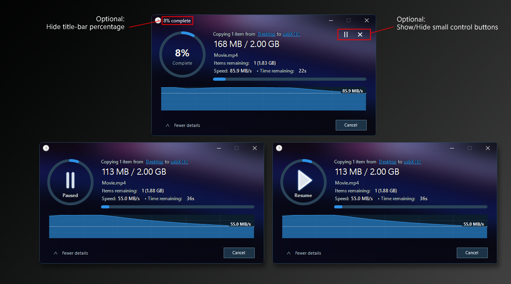
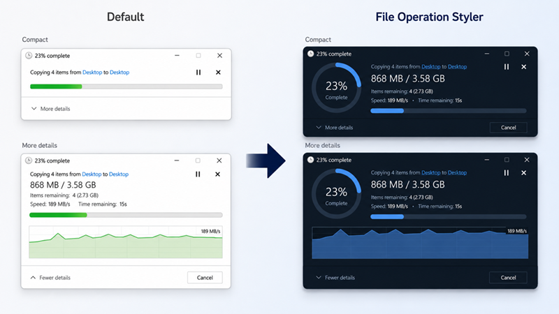
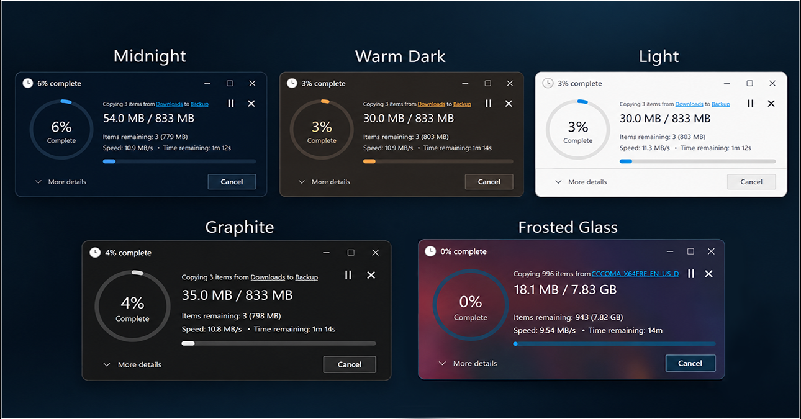

# File Operation Styler

A modern replacement for the standard Windows 11 file operation window.

File Operation Styler gives copy, move, delete, and recycle operations a cleaner modern layout while keeping the normal Windows file operation behavior.

## Screenshots

### Interactive Controls

The large progress circle can pause and resume operations, while optional settings can hide the smaller controls and title-bar percentage for a cleaner layout.

### Default vs File Operation Styler

### Themes

## What's new in 1.4.0

- Added experimental support for third-party file managers that use compatible native Windows copy dialogs.
- Improved Common Controls compatibility so the mod can also work in other application processes.
- Third-party file managers can be enabled manually through Windhawk's custom process inclusion list.
- Preserved the existing Windows Explorer functionality and appearance.

See the [complete changelog](https://github.com/digart11/File-Operation-Styler/blob/master/CHANGELOG.md) for the full release history.

## Features

- Modern copy, move, delete, and recycle operation window
- Circular overall progress indicator
- Current-file progress bar
- Transferred size, remaining items, speed, and estimated time
- Progress graph in More Details view
- Multiple file operations in one window, with automatic vertical scrolling when needed
- Pause, resume, and cancel controls
- Interactive Pause / Resume control in the large progress circle
- Option to hide the small Pause / Resume and Cancel buttons
- Option to hide the percentage from the window title
- Works with normal Windows conflict and error dialogs
- Several built-in themes, including Frosted Glass
- Windows Acrylic and Custom Blur glass styles
- Custom colors, fonts, text sizes, and progress thickness

## Using another file manager?

File Operation Styler works automatically with Windows Explorer. It can also work with some third-party file managers that use native Windows file-operation dialogs.

1. Open File Operation Styler in Windhawk and go to **Advanced**.
2. Find **Custom process inclusion list**.
3. Add the file manager's actual EXE filename, one per line.
4. Save and completely restart the file manager.

Tested examples:
- OneCommander: `OneCommander.exe`
- File Pilot 0.8.5 standalone: `FPilot.exe`

Compatibility may vary by program and version.

## Customization

Choose one of the included themes or adjust the available colors, typography, progress styling, and other presentation options to create your own look.

The Frosted Glass theme supports both Windows Acrylic and Custom Blur, including adjustable tint and opacity.

## Notes

File Operation Styler changes the appearance of the normal Windows file operation window only. Windows continues to handle the actual copy, move, delete, conflicts, errors, pause, resume, and cancel operations.

Settings changes apply to new file-operation windows; operations already in progress may use the native Windows presentation until they complete.

File Operation Styler has been tested on Windows 11 25H2 and 26H2 x64, including build 26300.9818. It relies on private Explorer and Shell presentation interfaces, so compatibility may vary between Windows builds. Unsupported presentations fall back to the native Windows UI.
